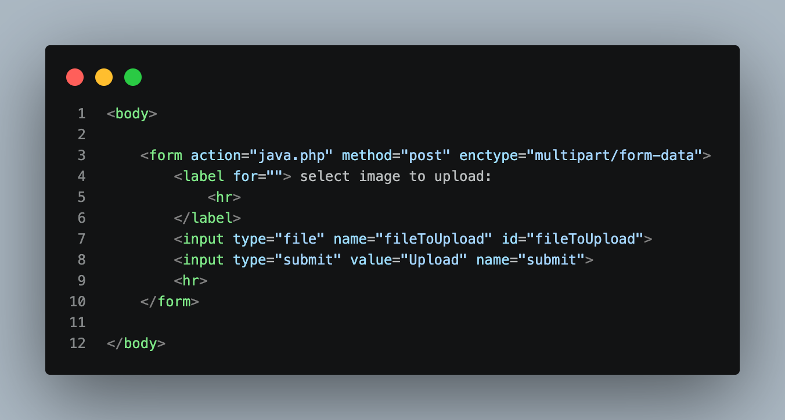
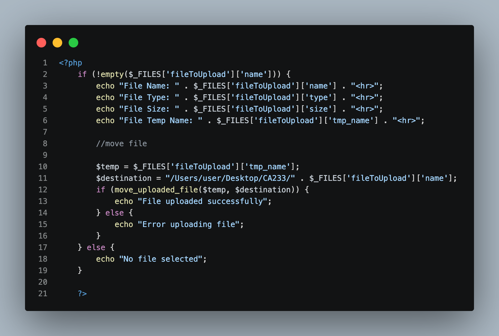

# Week 6 — Screenshots

## Overview

This README documents the screenshots inside the **Week 6 / Screenshots** folder for the **PHP & MySQL Course (CA233)**. Each screenshot captures one section of code from the Week 6 lab, and each section below explains **what the code does and the theory behind it**.

Week 6 has one topic:

- **File upload** (`index.php`, `java.php`): how an HTML form sends a file to the server, how PHP receives the file information in `$_FILES`, and how `move_uploaded_file()` saves the file in a permanent folder.

| # | Filename | Source File | Section Documented |
|---|---|---|---|
| 1 | `Img1.png` | `index.php` | The upload form: `enctype="multipart/form-data"`, file input and submit button |
| 2 | `Img2.png` | `java.php` | Reading `$_FILES` and moving the uploaded file with `move_uploaded_file()` |

---

# File Upload

## 1. `Img1.png` — The Upload Form



**What this screenshot shows:** the HTML form in `index.php`. It lets the user choose a file and sends it to `java.php` when the Upload button is clicked.

```html
<body>

    <form action="java.php" method="post" enctype="multipart/form-data">
        <label for=""> select image to upload:
            <hr>
        </label>
        <input type="file" name="fileToUpload" id="fileToUpload">
        <input type="submit" value="Upload" name="submit">
        <hr>
    </form>

</body>
```

**Theory — how a file reaches PHP**

A normal form sends only text. To send a file, the browser must send the **binary content** of the file, and that needs a special form setup. The flow is:

```
User chooses a file  →  clicks Upload  →  browser sends the file (POST, multipart)
        →  PHP stores it in a temporary folder  →  java.php receives its details in $_FILES
```

**Theory — the three form attributes that make uploading work**

| Attribute | Value | Why it is needed |
|---|---|---|
| `action` | `java.php` | The page that receives and processes the upload. |
| `method` | `post` | Files cannot be sent with `GET`. The file travels in the body of the request. |
| `enctype` | `multipart/form-data` | Tells the browser to split the data into parts so a file can be included. **Without it, the file is not sent**, and PHP only receives the file name. |

The `enctype` attribute is the most important one. It is the most common reason why an upload "does nothing".

**Theory — the file input**

```html
<input type="file" name="fileToUpload" id="fileToUpload">
```

- `type="file"` shows a **Choose File** button that opens the file picker of the computer.
- `name="fileToUpload"` becomes the **key** used in PHP: `$_FILES['fileToUpload']`. This is the link between the HTML and the PHP, just like the field names used with `$_POST`.
- `id="fileToUpload"` is used to connect the field to a `<label>`.

**Theory — the submit button**

`<input type="submit" value="Upload" name="submit">` sends the form. `value` is the text on the button, and `name` lets PHP detect that the form was submitted (`$_POST['submit']`).

**Concepts demonstrated:**

- **`enctype="multipart/form-data"`:** required for sending files.
- **`type="file"`:** the file selection field.
- **`name` attribute:** the key that PHP uses to find the file in `$_FILES`.
- **`<hr>`:** draws a horizontal line to separate parts of the page.

> **Note:** `<label for="">` has an empty `for` attribute, so it is not connected to any field. To connect it, use `for="fileToUpload"`, which matches the `id` of the input. Also, the label says "select image", but the field accepts **any** file type. Adding `accept="image/*"` limits the file picker to images, but this is only a browser convenience and not a security check.

---

## 2. `Img2.png` — Reading `$_FILES` and Moving the File



**What this screenshot shows:** the PHP code in `java.php`. It checks that a file was selected, prints the file information, and moves the file from the temporary folder to a permanent folder.

```php
<?php
    if (!empty($_FILES['fileToUpload']['name'])) {
        echo "File Name: " . $_FILES['fileToUpload']['name'] . "<hr>";
        echo "File Type: " . $_FILES['fileToUpload']['type'] . "<hr>";
        echo "File Size: " . $_FILES['fileToUpload']['size'] . "<hr>";
        echo "File Temp Name: " . $_FILES['fileToUpload']['tmp_name'] . "<hr>";

        //move file

        $temp = $_FILES['fileToUpload']['tmp_name'];
        $destination = "/Users/user/Desktop/CA233/" . $_FILES['fileToUpload']['name'];
        if (move_uploaded_file($temp, $destination)) {
            echo "File uploaded successfully";
        } else {
            echo "Error uploading file";
        }
    } else {
        echo "No file selected";
    }

    ?>
```

**Theory — the `$_FILES` superglobal**

Just as PHP fills `$_POST` with form text, it fills **`$_FILES`** with information about uploaded files. It is a **two-level array**: the first key is the `name` of the input (`fileToUpload`), and the second key is the piece of information.

| Key | Example | Meaning |
|---|---|---|
| `['name']` | `photo.png` | The original file name on the user's computer. |
| `['type']` | `image/png` | The file type (MIME type) reported by the browser. |
| `['size']` | `52341` | The file size in **bytes**. |
| `['tmp_name']` | `/tmp/phpAbC123` | The temporary location where PHP stored the file. |
| `['error']` | `0` | An error code. `0` (`UPLOAD_ERR_OK`) means success. |

The code in the screenshot prints the first four. The `error` key is not used in this example.

**Theory — the temporary file**

When a file is uploaded, PHP first saves it in a **temporary folder** on the server under a random name (`tmp_name`). This file is **deleted automatically when the script ends**. If the script does not move it, the upload is lost. This is why the second part of the code is needed.

**Theory — checking that a file was selected**

```php
if (!empty($_FILES['fileToUpload']['name'])) { ... } else { echo "No file selected"; }
```

If the user clicks Upload without choosing a file, the `name` is an **empty string**. `empty()` returns `true` for an empty string, and `!` reverses it, so the first block runs only when a real file was selected. Otherwise, the `else` block prints `No file selected`.

**Theory — `move_uploaded_file()`**

```php
$temp = $_FILES['fileToUpload']['tmp_name'];
$destination = "/Users/user/Desktop/CA233/" . $_FILES['fileToUpload']['name'];
move_uploaded_file($temp, $destination);
```

| Part | Meaning |
|---|---|
| `$temp` | Where the file is now (the temporary file). |
| `$destination` | Where the file should be saved: a folder path joined (with the concatenation operator `.`) to the original file name. |
| `move_uploaded_file()` | Moves the file and returns `true` on success or `false` on failure. |

The function is used instead of `copy()` or `rename()` because it first checks that the file **really came from an HTTP upload**, which protects against attacks that try to make PHP move other files on the server.

The `if / else` around the function prints a message for each result: `File uploaded successfully` or `Error uploading file`.

**Common reasons for `Error uploading file`:**

- The destination folder **does not exist**.
- The folder exists, but PHP **does not have permission to write** in it.
- The file is **larger** than the limits `upload_max_filesize` or `post_max_size` in `php.ini`.
- The path is written incorrectly. The path in this example is an absolute path on a Mac, so it must be changed on another computer (for example, a Windows path such as `C:/xampp/htdocs/uploads/`).

**Concepts demonstrated:**

- **Superglobal `$_FILES`:** a two-level array that describes the uploaded file.
- **`empty()` and `!`:** detect that no file was chosen.
- **Concatenation `.`:** builds each output line and the destination path.
- **Temporary file:** an upload exists only temporarily until it is moved.
- **`move_uploaded_file()`:** saves the upload in a permanent folder.
- **`if / else`:** reports success or failure.

**Example result** (after uploading a file named `photo.png`):

```
File Name: photo.png
File Type: image/png
File Size: 52341
File Temp Name: /tmp/phpAbC123
File uploaded successfully
```

Each line is followed by a horizontal line (`<hr>`). The file `photo.png` is now inside the `CA233` folder.

> **Notes for real applications:** this code is correct for learning the basics, but it must be improved before it is used on a real website:
> - **Do not trust `name` or `type`.** Both come from the user's browser and can be faked. Use `basename()` on the file name, check the extension against a list of allowed types (for example, `jpg`, `png`), and verify the real type on the server (for example, with `finfo_file()`).
> - **Check `$_FILES[...]['error']`** (it must be `0`) and limit `size` before moving the file.
> - **Avoid overwriting:** two users uploading `photo.png` would replace each other's file. Give each file a unique name, for example with `uniqid()`.
> - **Escape printed values** with `htmlspecialchars()`. A file name can contain HTML, so printing it directly is a Cross-Site Scripting (XSS) risk.
> - **Never allow uploading `.php` files** into a folder that the web server can run.

---

## Screenshot Folder Structure

```
Week 6/
├── index.php
├── java.php
└── Screenshots/
    ├── Img1.png
    ├── Img2.png
    └── README.md
```

Each image above corresponds to the matching numbered section in this README. `Img1` comes from the form file (`index.php`), and `Img2` comes from the processing file (`java.php`).
